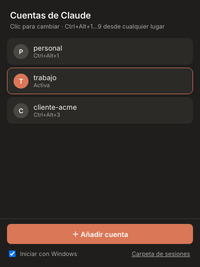

# Claude Account Switcher

Cambia de cuenta en Claude Desktop como en la app del celular: inicias sesión una vez por cuenta y después cambias con un clic, sin volver a autenticarte.

[Read in English](README.md)

<p align="center"></p>

> Proyecto independiente y comunitario. No está afiliado ni respaldado por Anthropic. "Claude" es una marca de Anthropic.

## Descarga

Baja la última versión desde **[Releases](https://github.com/msiufi/claude-account-switcher/releases/latest)**:

| Archivo | Para |
| --- | --- |
| `Claude-Switcher-Setup-x.y.z.zip` | **Windows** (recomendado). Descomprime y ejecuta el instalador. No pide permisos de administrador. |
| `Claude-Switcher-Portable-x.y.z.zip` | Windows sin instalar. Descomprime y ejecuta. |
| `Claude-Switcher-Python-x.y.z.zip` | Windows, macOS o Linux con Python 3.8+. |

Cada versión incluye `SHA256SUMS.txt` para verificar las descargas.

Los ejecutables de Windows todavía no están firmados, así que SmartScreen mostrará *"Windows protegió tu PC"*. Pulsa **Más información → Ejecutar de todas formas**. Cada versión se compila desde el código de este repo con [GitHub Actions](.github/workflows/release.yml).

## App de Windows

Vive en la bandeja del sistema, junto al reloj.

1. Abre Claude Desktop con la cuenta en la que ya estás.
2. Abre Claude Switcher, pulsa **Guardar cuenta actual** y ponle un nombre.
3. Pulsa **＋ Añadir cuenta**. Claude se abre sin sesión: inicia sesión una vez con la cuenta nueva.

Después:

- Clic en el icono de la bandeja y elige la cuenta, o **Ctrl+Alt+1…9** desde cualquier lugar.
- Doble clic en el icono para renombrar, ordenar o eliminar cuentas.
- Activa **Iniciar con Windows** para que arranque solo.

## Versión de Python (Windows, macOS, Linux)

Requiere Python 3.8+ con Tkinter (viene incluido en los instaladores de python.org).

```bash
cd python
python3 claude_switcher.py          # ventana
python3 claude_switcher.py list     # terminal: list, save, new, switch, rename, delete
```

También puedes hacer doble clic en `Abrir Claude Switcher (Mac).command` o `Abrir Claude Switcher (Windows).bat`. Más detalles en la [guía de la versión Python](python/LEEME.md).

## Cómo funciona

Claude Desktop guarda tu sesión en una carpeta local. El switcher guarda una copia por cuenta. Al cambiar, cierra Claude, guarda la carpeta actual en su perfil, pone en su lugar la del perfil elegido y vuelve a abrir Claude. Tarda unos segundos.

- `claude_desktop_config.json` (servidores MCP y extensiones) se comparte entre todas las cuentas.
- Los chats viven en la nube de cada cuenta. Nada se mezcla entre cuentas.
- Si una sesión caduca, solo esa cuenta pide iniciar sesión de nuevo.

Las dos versiones usan la misma carpeta de perfiles, así que puedes pasar de una a otra sin perder las cuentas guardadas.

## Seguridad

- **La carpeta `Claude-Switcher` contiene sesiones iniciadas.** Trátala como una contraseña: no la compartas, no la sincronices a lugares públicos y no la adjuntes en issues.
- Haz un respaldo de los datos de Claude Desktop antes del primer uso y termina lo que estés haciendo antes de cambiar, porque Claude se cierra.
- Desinstalar la app de Windows conserva los perfiles. Para borrarlos, elimina `%APPDATA%\Claude-Switcher`.

## Contribuir

Los reportes de errores, de compatibilidad y los pull requests son bienvenidos. Mira [CONTRIBUTING.md](CONTRIBUTING.md).

## Licencia

[MIT](LICENSE)
