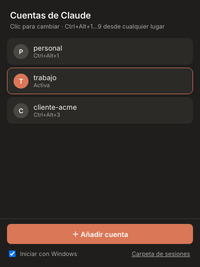

# Claude Account Switcher

Switch between Claude Desktop accounts the way the mobile app does: sign in once per account, then switch with one click, without signing in again.

[Leer en español](README.es.md)

<p align="center"></p>

> Independent, community project. Not affiliated with or endorsed by Anthropic. "Claude" is a trademark of Anthropic.

## Download

Get the latest version from **[Releases](https://github.com/msiufi/claude-account-switcher/releases/latest)**:

| File | For |
| --- | --- |
| `Claude-Switcher-Setup-x.y.z.zip` | **Windows** (recommended). Unzip and run the installer. No admin rights needed. |
| `Claude-Switcher-Portable-x.y.z.zip` | Windows, no install. Unzip and run. |
| `Claude-Switcher-Python-x.y.z.zip` | Windows, macOS or Linux, with Python 3.8+. |

Each release includes `SHA256SUMS.txt` so you can verify downloads.

The Windows builds are not code-signed yet, so SmartScreen will show *"Windows protected your PC"*. Click **More info → Run anyway**. Every release is built from this repository's source by [GitHub Actions](.github/workflows/release.yml).

## Windows app

The app lives in the system tray next to the clock.

1. Open Claude Desktop with the account you are already signed in to.
2. Open Claude Switcher and click **Guardar cuenta actual** (save current account). Give it a name.
3. Click **＋ Añadir cuenta** (add account). Claude reopens signed out; sign in once with the new account.

After that:

- Click the tray icon and pick an account, or press **Ctrl+Alt+1…9** from anywhere.
- Double-click the tray icon to rename, reorder or delete accounts.
- Turn on **Iniciar con Windows** to start it at login.

The interface is currently in Spanish. Translations are welcome.

## Python version (Windows, macOS, Linux)

Requires Python 3.8+ with Tkinter (included in the python.org installers).

```bash
cd python
python3 claude_switcher.py          # window
python3 claude_switcher.py list     # command line: list, save, new, switch, rename, delete
```

You can also double-click `Abrir Claude Switcher (Mac).command` or `Abrir Claude Switcher (Windows).bat`. See the [Spanish guide](python/LEEME.md) for details.

## How it works

Claude Desktop keeps its session in a local data folder. The switcher keeps one copy of that folder per account. To switch, it closes Claude, moves the current folder into its profile, moves the selected profile into place, and reopens Claude. A switch takes a few seconds.

- `claude_desktop_config.json` (MCP servers and extensions) is shared across all accounts.
- Your chats live in each account's cloud storage. Nothing is merged between accounts.
- If a session expires, only that account needs to sign in again.

| Platform | Claude data | Saved profiles |
| --- | --- | --- |
| Windows | `%APPDATA%\Claude` (or the MSIX package folder) | `%APPDATA%\Claude-Switcher` |
| macOS | `~/Library/Application Support/Claude` | `~/Library/Application Support/Claude-Switcher` |
| Linux | `~/.config/Claude` | `~/.config/Claude-Switcher` |

Both versions use the same profile folder, so you can move between them without losing saved accounts.

## Safety

- **The `Claude-Switcher` folder contains signed-in sessions.** Treat it like a password: don't share it, sync it to public places, or attach it to issues.
- Back up your Claude Desktop data before first use, and finish active work before switching, because Claude closes.
- Uninstalling the Windows app keeps saved profiles. Delete `%APPDATA%\Claude-Switcher` to remove them.
- Compatibility can change with Claude Desktop updates. Please report breakage.

## Repository layout

```
windows/   Electron tray app (Windows installer and portable)
python/    Cross-platform Python + Tkinter version
docs/      Images for this README
```

## Contributing

Bug reports, compatibility reports and pull requests are welcome. See [CONTRIBUTING.md](CONTRIBUTING.md). Report vulnerabilities privately as described in [SECURITY.md](SECURITY.md).

## License

[MIT](LICENSE)
